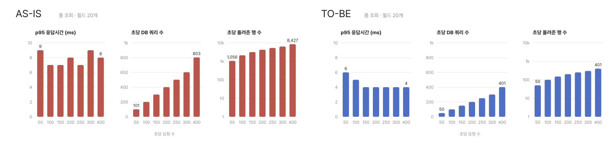
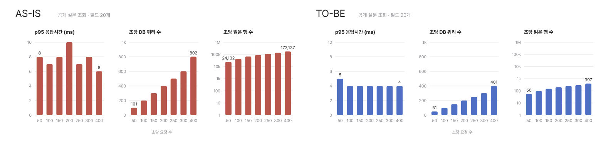
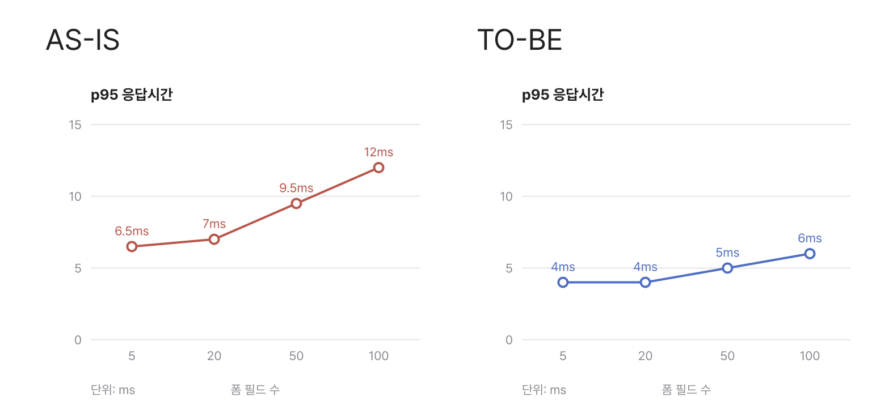

# 필드 jsonb 전환 전후 측정

폼 필드·설문 문항을 행마다 따로 두던 `dynamic_form`·`dynamic_survey`에서 부모 행의 jsonb 배열(`form.fields`,
`survey.questions`)로 옮긴 전후를 같은 조건으로 쟀다. 방법은 [README.md](README.md).

- 측정일 2026-11-17, MacBook 로컬. 앱 1개(`node dist/main`)와 Docker PostgreSQL 17(`pg_stat_statements`).
- 시드: 박람회 200개, 폼·설문마다 필드 20개. 단계마다 30초, 도착률 고정(`Precise Throughput Timer`).
- AS-IS는 이 브랜치의 측정 도구로 `develop` 코드를, TO-BE는 이 브랜치 코드를 같은 DB에서 쟀다(같은 시드에 전환
  마이그레이션만 적용).
- 요청당 쿼리·돌려준 행은 `pg_stat_statements`의 `calls`·`rows`, 읽은 행은 `pg_stat_user_tables`의
  `seq_tup_read + idx_tup_fetch`(`form`·`survey`·옛 필드 테이블) 증가분을 요청 수로 나눈 값이다.

## 결과

### 폼 조회 `GET /forms/:expoId?type=STANDARD&applicationType=PRE` (AS-IS → TO-BE)

| 초당 요청 | p95 (ms) | p99 (ms) | 요청당 쿼리 | 요청당 돌려준 행 | 요청당 읽은 행 | 오류 |
|---:|---:|---:|---:|---:|---:|---:|
| 50 | 9 → 6 | 19 → 10 | 2.01 → 1.00 | 21 → 1 | 240 → 1 | 0.00% → 0.00% |
| 100 | 7 → 5 | 13 → 9 | 2.00 → 1.00 | 21 → 1 | 234 → 1 | 0.00% → 0.00% |
| 150 | 7 → 4 | 14 → 9 | 2.00 → 1.00 | 21 → 1 | 246 → 1 | 0.00% → 0.00% |
| 200 | 8 → 4 | 20 → 9 | 2.00 → 1.00 | 21 → 1 | 239 → 1 | 0.00% → 0.00% |
| 250 | 7 → 4 | 15 → 9 | 2.00 → 1.00 | 21 → 1 | 244 → 1 | 0.00% → 0.00% |
| 300 | 9 → 4 | 90 → 9 | 2.00 → 1.00 | 21 → 1 | 238 → 1 | 0.00% → 0.00% |
| 400 | 8 → 4 | 18 → 9 | 2.00 → 1.00 | 21 → 1 | 243 → 1 | 0.00% → 0.00% |

### 공개 설문 조회 `GET /surveys/public/:expoId` (AS-IS → TO-BE)

| 초당 요청 | p95 (ms) | p99 (ms) | 요청당 쿼리 | 요청당 돌려준 행 | 요청당 읽은 행 | 오류 |
|---:|---:|---:|---:|---:|---:|---:|
| 50 | 8 → 5 | 13 → 7 | 2.01 → 1.01 | 21 → 1 | 481 → 1 | 0.00% → 0.00% |
| 100 | 7 → 4 | 13 → 7 | 2.00 → 1.00 | 21 → 1 | 430 → 1 | 0.00% → 0.00% |
| 150 | 8 → 4 | 181 → 8 | 2.00 → 1.00 | 21 → 1 | 442 → 1 | 0.00% → 0.00% |
| 200 | 10 → 4 | 65 → 9 | 2.00 → 1.00 | 21 → 1 | 433 → 1 | 0.00% → 0.00% |
| 250 | 7 → 4 | 16 → 8 | 2.00 → 1.00 | 21 → 1 | 443 → 1 | 0.00% → 0.00% |
| 300 | 8 → 4 | 22 → 9 | 2.00 → 1.00 | 21 → 1 | 445 → 1 | 0.00% → 0.00% |
| 400 | 6 → 4 | 11 → 9 | 2.00 → 1.00 | 21 → 1 | 432 → 1 | 0.00% → 0.00% |

## 해석

- **쿼리 2개 → 1개.** 전에는 TypeORM이 관계 조회를 `SELECT DISTINCT` 하위 쿼리와 본 조인 두 번으로 나눠 실행했다.
  이제 부모 행 하나만 읽는다.
- **돌려준 행 21개 → 1개.** 필드 20개가 20행으로 펼쳐져 오던 것이 배열 하나가 됐다.
- **읽은 행(`pg_stat_user_tables`)은 참고값이다.** AS-IS 요청당 약 240·440행은 원인을 확인하지 못했다. 첫 쿼리를 비슷하게
  재현한 실행 계획은 인덱스로 수십 행만 읽었고, 남는 차이는 시드의 폼 수(200개)와 비슷해 시드 크기에 따라 달라지는 값으로 본다.
  전후 비교의 근거로는 쿼리 수와 돌려준 행 수를 쓴다.
- **p95는 7~10ms → 4~6ms.** 로컬 단일 머신이라 절대값보다 방향만 본다. 이 범위(400 req/s까지)에서는 두 방식 모두
  포화되지 않았다. AS-IS의 p99 튀는 값(90ms, 181ms)은 한 번만 잰 구간의 잡음으로 보고 결론에 쓰지 않는다.
- 응답 JSON은 전후가 바이트 단위로 같았다(같은 시드에서 두 API 응답을 `cmp`로 비교).

## 재지 않은 것

- 공개 설문 제출(`POST /surveys/answer/public/:expoId`): 설문 행 락에서 줄을 서는 경로라 읽기 차이가 가려진다.
- 수정 경로: 전에는 필드 N행 DELETE + N행 INSERT, 이제 부모 행 UPDATE 1문장이다. 통합 테스트로 동작만 확인했다.
- 운영 필드 수 분포: 20개를 대표값으로 가정했다.

## 한계 부하 (초당 600~2,000건, 2026-11-18)

같은 조건으로 순서를 바꿔 두 번(AS-IS 먼저, TO-BE 먼저), 원인 확인용으로 한 번 더 쟀다(단계마다 20초).

- 두 방식 모두 초당 2,000건까지 포화되지 않았다. p50은 모두 1~2ms다.
- p95·p99는 단계마다 수십~300ms대로 튀었는데, 어느 쪽이 튀는지가 회차마다 바뀌었다(1·2회차는 AS-IS, 3회차는 TO-BE).
- 원인 확인: 쿼리 실행 시간은 요청당 약 0.05ms, GC 한 번 멈춤은 최대 약 10ms였고, 튀는 구간에는 이벤트 루프가
  최대 50~117ms 멈췄다. 부하 발생기(JMeter)·DB·앱이 한 노트북에서 CPU를 나눠 쓰며 생긴 멈춤으로 보고,
  응답시간 차이는 이 환경에서 결론을 내지 않는다.
- 확실한 차이는 DB가 돌려준 행이다. 같은 요청 4만 건에서 AS-IS는 본 쿼리 80만 2,880행과 id 조회 4만 행,
  TO-BE는 4만 134행이었다.

## 반복 측정 (초당 200건, 2026-11-18)

측정 순서 영향을 없애려고 AS-IS → TO-BE → TO-BE → AS-IS → AS-IS → TO-BE 순서로 3번씩 쟀다. 매번 10초 예열 후
30초 측정, 측정 전 응답이 기준 JSON과 같은지 확인했다.

| | p50 | p95 | p99 | 오류 |
| --- | ---: | ---: | ---: | ---: |
| 폼 AS-IS (3회) | 4 / 4 / 4ms | 9 / 8 / 9ms | 18 / 15 / 16ms | 0% |
| 폼 TO-BE (3회) | 2 / 2 / 2ms | 5 / 5 / 5ms | 10 / 11 / 12ms | 0% |
| 설문 AS-IS (3회) | 4 / 4 / 4ms | 8 / 8 / 8ms | 16 / 14 / 15ms | 0% |
| 설문 TO-BE (3회) | 2 / 2 / 2ms | 5 / 5 / 5ms | 10 / 11 / 12ms | 0% |

6번 모두 TO-BE가 빨랐다. 평균으로 p50 4 → 2ms(50%), p95 8.3 → 5.0ms(40%), p99 15.7 → 11.0ms(30%).

## 필드 수별 (초당 200건, 2026-11-18)

필드 5·20·50·100개로 시드를 바꿔 가며 폼 조회를 쟀다(필드 수마다 AS-IS → TO-BE → TO-BE → AS-IS, 30초씩).
요청당 돌려준 행이 필드 수 + 1(AS-IS)과 1(TO-BE)로 나와 시드가 맞게 들어간 것을 확인했다.

| 필드 수 | AS-IS p95 | TO-BE p95 | 단축 | AS-IS p50 | TO-BE p50 |
| ---: | ---: | ---: | ---: | ---: | ---: |
| 5 | 6.5ms | 4ms | 38% | 3ms | 2ms |
| 20 | 7ms | 4ms | 43% | 4ms | 2ms |
| 50 | 9.5ms | 5ms | 47% | 4.5ms | 2ms |
| 100 | 12ms | 6ms | 50% | 5ms | 3ms |

필드가 5 → 100개로 늘 때 AS-IS p95는 5.5ms 늘었고 TO-BE는 2ms 늘었다. TO-BE도 배열이 커지는 만큼 조금 늘지만
증가폭이 AS-IS의 약 3분의 1이다. 운영 폼은 필드 2~6개라 실제 차이는 첫 줄(5개)에 가깝다.

